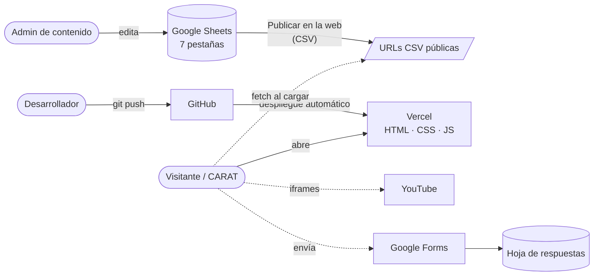

# SVTFLIX en Español — Plan del proyecto

> Versión 0.1 · 2026-11-02 · Estado: **borrador para revisar en equipo**
>
> Documentos relacionados:
> [02-REQUERIMIENTOS](02-REQUERIMIENTOS.md) · [03-HISTORIAS-DE-USUARIO](03-HISTORIAS-DE-USUARIO.md) · [04-CASOS-DE-USO](04-CASOS-DE-USO.md) · [00-especificacion-original](00-especificacion-original.md)

---

## 1. Qué vamos a construir

Pasar el sitio fan **SVTFLIX en Español** (hoy hecho en Canva: <https://svtflixesp.my.canva.site/>) a una **web propia en código**, con estética de plataforma de streaming, que recopila contenido de SEVENTEEN subtitulado al español.

El contenido (portada, integrantes, videos, música, programas, redes y créditos) se **edita desde una hoja de Google Sheets**, sin tocar código. La web lee esa hoja al abrirse.

### Por qué salir de Canva
- En Canva cada sección es un diseño incrustado aparte (8 incrustaciones): pesa, no se puede buscar y cuesta mantenerlo.
- Para añadir un video hay que editar el diseño y volver a publicar.
- No hay ficha de integrante, ni reproductor propio, ni control del aspecto en móvil.

## 2. Restricciones (no negociables)

| # | Restricción | Consecuencia |
|---|---|---|
| R1 | **Coste cero.** No hay monetización. | Nada de servidores ni bases de datos de pago. |
| R2 | **Web estática, sin backend propio.** | Solo HTML, CSS y JS servidos por Vercel. Los datos se leen de Google Sheets publicado como CSV. |
| R3 | **Sin registros ni cuentas.** | No hay login, perfiles, favoritos en servidor ni comentarios. |
| R4 | **Sitio fan, no oficial.** | Aviso visible, créditos a los equipos de subtítulos y nada de marcas registradas ajenas (logo o tipografía de Netflix). |

## 3. Alcance

### Dentro (v1.0)
- Cabecera con logo y enlace **CARAT** (Weverse).
- **Portada (hero)** con teaser en bucle silenciado, logo del álbum, botón *Reproducir* y botón secundario.
- **Conoce a los 13 miembros**: carrusel "Top 13" con números gigantes y **ficha (modal)** de cada integrante con su música y sus programas.
- **Sigue a SEVENTEEN** (X, Instagram, YouTube, página oficial…) y **Escucha a SEVENTEEN** (Spotify, Apple Music, YouTube Music).
- **Catálogo por filas**: Música, Predebut, Contenido diverso, Going Seventeen, Proyecciones… Las categorías salen de la hoja, no del código.
- **Reproductor** dentro del sitio (video o lista de YouTube) y botón *Ver en YouTube*.
- **Sugerencias y preguntas**: formulario sin backend propio (ver decisión D1).
- **Agradecimientos y créditos** y pie con aviso legal.
- Adaptado a móvil, con fallback de imágenes y estados de carga.

### Fuera (por ahora)
- Cuentas, "Mi lista" sincronizada, comentarios, valoraciones.
- Subir o alojar videos propios (todo vive en YouTube).
- Panel de administración propio (el panel **es** Google Sheets).
- Varios idiomas.

### Opcional si da tiempo (v1.1)
- Buscador por título (en el navegador, sin servidor).
- Enlace directo a la ficha de un integrante (`/#miembro/hoshi`).

## 4. Arquitectura



**Cómo funciona, en simple:**
1. El visitante abre la web, y Vercel le entrega los archivos estáticos.
2. El navegador del visitante pide en paralelo las 7 pestañas de la hoja (CSV público).
3. El JavaScript convierte esas filas en secciones. Si una pestaña falla, el resto sigue funcionando.
4. Los videos se ven con el reproductor incrustado de YouTube.
5. Las sugerencias van a un Google Form, y las respuestas caen en otra hoja que solo ve el equipo.

### Stack

| Pieza | Elección | Motivo |
|---|---|---|
| Estructura | HTML5 semántico | Lo pide la especificación. Accesible. |
| Estilos | **Tailwind CSS v4 (CLI)**, compilado en Vercel | El CDN "play" de Tailwind no es para producción. La compilación en Vercel es gratis. |
| Lógica | JavaScript vanilla (módulos ES) | Sin framework, sin dependencias pesadas. |
| CSV | **PapaParse** (versión fija) | Maneja comas y saltos de línea dentro de celdas. |
| Contenido | Google Sheets → *Publicar en la web* → CSV | Gratis, editable por no técnicos. |
| Video | YouTube IFrame API sobre `youtube-nocookie.com` | Detecta videos que no permiten incrustarse y cuida la privacidad. |
| Formulario | Google Forms (ver D1) | Gratis, sin límite, las respuestas quedan en una hoja. |
| Código | Git + GitHub (`Nakusuo/svtflix`) | Gitflow como en otros proyectos. |
| Hosting | Vercel Hobby | HTTPS, CI/CD y dominio `.vercel.app` gratis. |

### Estructura de carpetas propuesta

```
SVTFLIX/
├── src/
│   └── styles.css              # entrada de Tailwind: tokens de diseño y capas propias
├── web/                        # ← lo que se publica (outputDirectory de Vercel)
│   ├── index.html
│   ├── css/styles.css          # generado por Tailwind (no se sube a git)
│   ├── img/                    # logo, placeholder, favicon, fotos de integrantes
│   └── js/
│       ├── main.js             # arranque (DOMContentLoaded)
│       ├── config.js           # URLs de las 7 pestañas CSV (único lugar)
│       ├── datos.js            # fetch + PapaParse + normalizar + caché
│       ├── youtube.js          # extraer IDs, miniaturas, URLs de embed
│       ├── seguro.js           # crear elementos sin innerHTML, validar URLs
│       ├── vendor/papaparse.min.js
│       └── ui/
│           ├── hero.js  top13.js  modal-miembro.js  catalogo.js
│           └── reproductor.js  redes.js  sugerencias.js  creditos.js
├── vercel.json                 # build, carpeta publicada, cabeceras de seguridad
├── package.json                # solo Tailwind CLI como dependencia
└── docs/
```

> Solo se publica `web/`. `docs/`, `src/` y `node_modules/` nunca llegan a la web.
> La especificación original habla de `index.html`, `styles.css` y `script.js`. Lo dividimos en módulos para poder mantenerlo, pero sigue siendo JS vanilla sin framework.

### Cómo arrancar en local
```bash
npm install        # solo la primera vez
npm run dev        # compila Tailwind en modo vigilancia y sirve en http://localhost:5500
```

## 5. Fases y entregables

Cada fase termina con una rama `release/*` → `main` y un tag. Vercel publica `main` y crea vistas previas de `develop` y de las ramas.

| Fase | Objetivo | Entregables | HU incluidas | Hecho cuando… |
|---|---|---|---|---|
| **0. Contenido** | Pasar el contenido de Canva a la hoja | Hoja con las 7 pestañas, inventario de las listas de YouTube actuales, fotos de los 13 | HU-19 a HU-22, HU-24 | La hoja tiene todo lo que hoy muestra Canva y está publicada como CSV |
| **1. Entorno y CI/CD** | Repo y despliegue | Repo en GitHub, proyecto en Vercel, Tailwind compilando, `vercel.json` | HU-29 | Un push a `develop` genera una vista previa en Vercel |
| **2. Motor de datos** | Leer y normalizar la hoja | `datos.js`, `youtube.js`, `seguro.js`, caché local | HU-23, HU-28 | La consola muestra las 7 pestañas ya normalizadas; si se corta la red, carga la última copia |
| **3. Maqueta y Top 13** | Esqueleto visual | Cabecera, hero, Top 13 con números, redes, filas del catálogo, pie | HU-01–05, HU-10, HU-14, HU-15, HU-17, HU-18, HU-25–27 | Se ve bien de 360 px a 1920 px y en 1366×768 |
| **4. Interacción** | Modales y reproductor | Ficha de integrante, reproductor, filtros de música y programas | HU-06–08, HU-11, HU-12 | Se abre y cierra con ratón, táctil y teclado; un video que no se puede incrustar ofrece *Ver en YouTube* |
| **5. Comunidad** | Formulario | Formulario de sugerencias conectado a Google Forms | HU-16 | Una respuesta de prueba llega a la hoja de respuestas |
| **6. QA y lanzamiento** | Calidad y salida | Informe de Lighthouse, pruebas en dispositivos, metadatos OG, dominio | HU-30 + revisión general | Se cumplen los RNF de [02-REQUERIMIENTOS](02-REQUERIMIENTOS.md) y el equipo da el visto bueno |
| *(v1.1)* | Extras | Buscador y enlace directo a ficha | HU-09, HU-13 | — |

### Definición de "terminado" para cualquier HU
- Cumple sus criterios de aceptación.
- Funciona en Chrome y Firefox de escritorio y en Chrome Android / Safari iOS.
- No muestra errores en consola con la hoja correcta.
- Se puede usar con teclado.
- Tiene vista previa en Vercel revisada por otra persona.

## 6. Riesgos

| Riesgo | Prob. | Impacto | Mitigación |
|---|---|---|---|
| Google tarda unos 5 minutos en reflejar los cambios del CSV publicado: no es "tiempo real". | Alta | Bajo | Avisarlo en la guía de edición. |
| Los canales de fansubs borran videos o listas (strikes). | Alta | Medio | Formulario con la opción "links rotos". Miniatura de reserva. Reproductor que detecta errores. |
| Videos con la incrustación desactivada. | Media | Medio | La IFrame API detecta los errores 101/150 y muestra *Ver en YouTube*. |
| El autoplay del hero se bloquea en móvil o en ahorro de batería. | Alta | Bajo | Imagen póster de fondo. El video entra solo si de verdad arranca. |
| Fotos enlazadas desde webs externas (Pinterest, Instagram…) que bloquean el hotlink. | Alta | Medio | Alojar las imágenes fijas en el repo o en un servicio de imágenes (D3), y `onerror` → placeholder. |
| Alguien renombra o borra una columna de la hoja. | Media | Alto | Normalizar los encabezados, mostrar avisos claros en consola, no romper el resto de secciones y proteger los encabezados en Sheets. |
| Texto malicioso en la hoja (XSS) si alguien obtiene permisos de edición. | Baja | Alto | Nunca usar `innerHTML` con datos de la hoja, aceptar solo URLs `https:` y añadir cabecera CSP en `vercel.json`. |
| Reclamo por derechos de imagen o marca. | Baja | Alto | Aviso de sitio fan, créditos y sin logo ni fuente de Netflix. Las imágenes son material promocional público. |
| Google cambia el endpoint de Google Forms. | Baja | Medio | Enlace de reserva al formulario original. |

## 7. Decisiones

### Tomadas
- **D0.** Sin backend propio. Google Sheets (CSV publicado) es la única fuente de contenido.
- **D0.1.** Se añaden 2 pestañas a la hoja de la especificación: `Redes` y `Creditos`. En Canva esas secciones existen y la especificación no las contemplaba.
- **D0.2.** Una categoría del catálogo puede apuntar a **un video o a una lista de YouTube**, como hace Canva hoy con las listas.

### Pendientes (necesitan respuesta del equipo)
| ID | Pregunta | Recomendación |
|---|---|---|
| **D1** | ¿Cómo recibir sugerencias sin backend? | **Formulario con nuestro diseño que envía a Google Forms.** Es gratis y sin límite. Alternativas: incrustar el Google Form tal cual (se ve fuera de estilo) o Formspree (50 envíos al mes gratis). |
| **D2** | ¿Los videos se abren dentro de la web o en YouTube como ahora? | **Dentro (modal)**, siempre con botón *Ver en YouTube*. |
| **D3** | ¿Dónde alojamos las fotos de los integrantes y las portadas? | **En el repo** (`public/img/`): cambian poco y nunca se rompen. Las miniaturas de videos, automáticas desde YouTube. |
| **D4** | ¿Mantenemos el look rojo y negro tipo Netflix del Canva o le damos más personalidad propia? | Mantener la *estructura* de streaming (hero, filas, Top 10) con **identidad propia**: logo SVTFLIX, paleta inspirada en los colores de SEVENTEEN (Rose Quartz y Serenity) sobre negro, profundidad y microinteracciones. |
| **D5** | ¿Quién edita la hoja? | Dar acceso de edición solo a las admins de @SVTFLIX_ESP y proteger la fila de encabezados. |
| **D6** | ¿Nombre del dominio en Vercel? | `svtflix-esp.vercel.app` |
| **D7** | ¿El enlace "CARAT" de la cabecera sigue yendo a Weverse? | Sí, configurable desde `Redes`. |

## 8. Equipo y roles

| Rol | Quién | Responsabilidad |
|---|---|---|
| Producto / contenido | @SVTFLIX_ESP | Decidir qué se muestra y mantener la hoja |
| Diseño | Por definir | Estilo visual, revisión de pantallas |
| Desarrollo | Nakusu (+ Claude) | Código, despliegue, QA |
