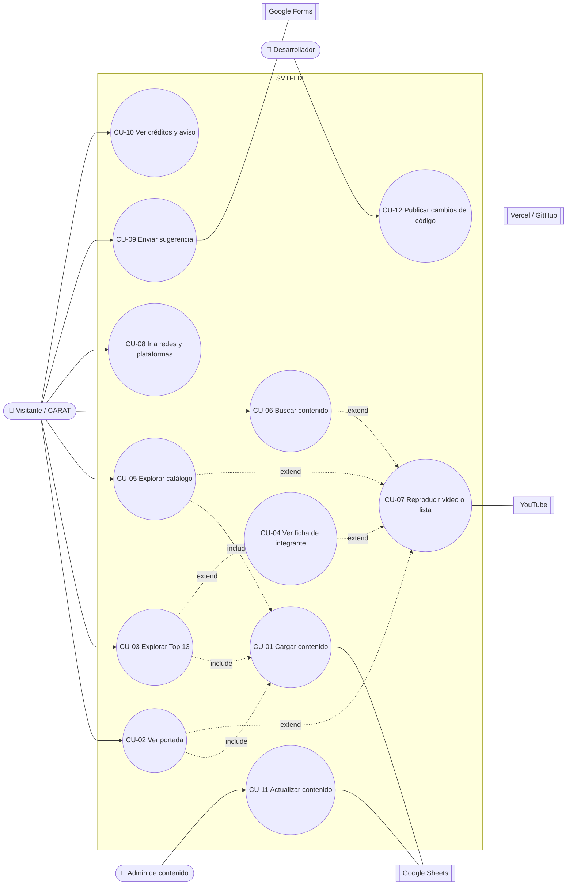

# SVTFLIX en Español — Casos de uso

> Versión 0.1 · 2026-11-02 · Ver también [02-REQUERIMIENTOS](02-REQUERIMIENTOS.md) · [03-HISTORIAS-DE-USUARIO](03-HISTORIAS-DE-USUARIO.md)

## Diagrama general

*include* = siempre ocurre como parte del caso. *extend* = ocurre solo si el usuario lo elige.

---

## CU-01 · Cargar contenido del sitio
| Campo | Detalle |
|---|---|
| **Actor principal** | Visitante (indirecto), sistema Google Sheets |
| **Objetivo** | Tener en memoria las 9 pestañas normalizadas para pintar la web. |
| **Precondiciones** | `config.js` tiene las 9 URLs CSV publicadas. |
| **Disparador** | Evento `DOMContentLoaded`. |
| **RF / HU** | RF-01–06, RF-31 · HU-23, HU-26, HU-28 |

**Flujo principal**
1. El sistema pinta la estructura estática y los esqueletos.
2. El sistema lanza 9 peticiones `fetch` en paralelo (`Promise.allSettled`).
3. Por cada respuesta, PapaParse convierte el CSV en filas.
4. El sistema normaliza los encabezados, quita las filas vacías e inactivas, valida las URLs y ordena.
5. El sistema guarda una copia de cada pestaña válida en `localStorage` con su fecha.
6. El sistema entrega los datos a cada sección y quita los esqueletos.

**Flujos alternativos**
- **4a. Falta una columna obligatoria:** la sección afectada muestra "Contenido no disponible ahora", la consola indica la pestaña y la columna, y el resto continúa.
- **4b. Una fila no es válida** (sin título o con URL mala): se omite y se avisa en consola con pestaña y número de fila.

**Excepciones**
- **2a. Una pestaña falla** (red, 404, tiempo agotado > 8 s): se usa su copia en `localStorage`. Si no existe, aplica 4a para esa sección.
- **2b. Fallan todas y no hay copia:** pantalla con "No pudimos cargar el contenido" y botón *Reintentar*, que vuelve al paso 2.

**Postcondición:** cada sección tiene datos válidos o muestra un mensaje controlado. Nunca queda una página en blanco.

---

## CU-02 · Ver la portada (hero)
| Campo | Detalle |
|---|---|
| **Actor principal** | Visitante |
| **Precondiciones** | CU-01 cargó `Portada`. |
| **RF / HU** | RF-07–11 · HU-01–03 |

**Flujo principal**
1. El sistema elige la primera fila activa de `Portada`.
2. El sistema muestra el póster, el logo o título, el subtítulo y los botones.
3. Cuando el póster ya se ve, el sistema crea el iframe del teaser (silenciado, autoplay, loop, sin controles).
4. Cuando YouTube avisa de que el video está reproduciéndose, el sistema hace un fundido del póster al video.
5. El visitante pulsa **Reproducir** → **extiende a CU-07** con `URL_Boton_Principal`.

**Flujos alternativos**
- **3a. *Reducir movimiento* activado:** no se crea el iframe y queda el póster.
- **4a. El video no arranca en 5 s o da error:** se queda el póster y no se muestra ningún error al visitante.
- **5a. El visitante pulsa el botón secundario:** se abre `URL_Boton_Secundario` en pestaña nueva, o en el reproductor si es de YouTube.

---

## CU-03 · Explorar el Top 13
| Campo | Detalle |
|---|---|
| **Actor principal** | Visitante |
| **Precondiciones** | CU-01 cargó `Miembros`. |
| **RF / HU** | RF-12–14 · HU-04, HU-05 |

**Flujo principal**
1. El sistema ordena los integrantes por `Numero` y crea cada tarjeta con su número gigante en capas.
2. El visitante desplaza el carrusel (flechas, deslizamiento, rueda o teclado).
3. El sistema actualiza la visibilidad de las flechas según la posición.
4. El visitante elige un integrante → **extiende a CU-04**.

**Flujos alternativos**
- **1a. No hay 13 filas:** se muestran las que haya y la consola avisa.
- **1b. Una foto falla:** se ve el placeholder (RF-31).

---

## CU-04 · Ver la ficha de un integrante
| Campo | Detalle |
|---|---|
| **Actor principal** | Visitante |
| **Precondiciones** | CU-03 en curso, o una URL con `#miembro/<id>` (RF-19). |
| **RF / HU** | RF-15–19 · HU-06–09 |

**Flujo principal**
1. El visitante pulsa una tarjeta.
2. El sistema abre el modal, bloquea el scroll del fondo, mueve el foco al título y actualiza la URL a `#miembro/<id>`.
3. El sistema muestra la foto de fondo, los datos y la biografía, omitiendo los campos vacíos.
4. El sistema filtra `Musica` y `Programas` por el integrante (RN-01) y pinta las dos filas.
5. El visitante pulsa un elemento → **extiende a CU-07**. Al cerrar el reproductor vuelve a la ficha.
6. El visitante cierra la ficha (X, `Esc`, clic fuera o *atrás*).
7. El sistema cierra el modal, restaura el scroll, devuelve el foco a la tarjeta y limpia la URL.

**Flujos alternativos**
- **4a. No hay música o programas:** la fila muestra "Aún no hay contenido".
- **1a. Llegada por enlace directo con un `id` inexistente:** se ignora el hash y se muestra la página normal.
- **3a. Instagram vacío:** no se muestra el botón.

---

## CU-05 · Explorar el catálogo por categorías
| Campo | Detalle |
|---|---|
| **Actor principal** | Visitante |
| **Precondiciones** | CU-01 cargó `Enlaces`. |
| **RF / HU** | RF-21, RF-24, RF-25 · HU-10 |

**Flujo principal**
1. El sistema agrupa los `Enlaces` por `Categoria` y los ordena (RF-21).
2. Por cada elemento, el sistema calcula la miniatura (RF-24) y crea la tarjeta.
3. El visitante desplaza la fila que le interesa.
4. El visitante pulsa una tarjeta → **extiende a CU-07**.

**Flujos alternativos**
- **2a. URL de lista sin miniatura:** placeholder con el título encima.
- **4a. URL que no es de YouTube:** se abre en pestaña nueva (RN-05).
- **1a. Categoría sin elementos válidos:** la fila no se crea (RN-03).

---

## CU-06 · Buscar contenido *(v1.1)*
| Campo | Detalle |
|---|---|
| **Actor principal** | Visitante |
| **RF / HU** | RF-26 · HU-13 |

**Flujo principal**
1. El visitante abre el buscador (icono de lupa o tecla `/`).
2. El visitante escribe 2 caracteres o más.
3. El sistema filtra `Enlaces`, `Musica` y `Programas` por título normalizado y muestra los resultados en una cuadrícula.
4. El visitante pulsa un resultado → **extiende a CU-07**.

**Flujo alternativo**
- **3a. Sin resultados:** mensaje con enlace a CU-09 (tipo "Contenido que quieres que se agregue").

---

## CU-07 · Reproducir un video o una lista
| Campo | Detalle |
|---|---|
| **Actor principal** | Visitante |
| **Actor secundario** | YouTube |
| **Precondiciones** | El elemento tiene una URL de YouTube válida (RF-25). |
| **RF / HU** | RF-22, RF-23 · HU-02, HU-11, HU-12 |

**Flujo principal**
1. El sistema extrae el tipo (video o lista) y el ID de la URL.
2. El sistema abre el modal del reproductor con el título y el botón *Ver en YouTube*.
3. El sistema crea el reproductor (IFrame API, `youtube-nocookie.com`) y empieza la reproducción.
4. El visitante ve el contenido y puede ir a pantalla completa.
5. El visitante cierra el reproductor y el sistema destruye el iframe, con lo que el audio se detiene.

**Flujos alternativos**
- **3a. Error 101/150 (no se permite incrustar):** "Este video solo puede verse en YouTube" y botón destacado.
- **3b. Error 100 (no existe):** "Este video ya no está disponible" y enlace a CU-09 con el tipo "Informes de errores (links rotos)" ya elegido y el título rellenado.
- **4a. El visitante pulsa *Ver en YouTube*:** se abre la URL original en pestaña nueva y el reproductor se pausa.

---

## CU-08 · Ir a redes y plataformas
| Campo | Detalle |
|---|---|
| **Actor principal** | Visitante |
| **RF / HU** | RF-07, RF-20 · HU-14, HU-15 |

**Flujo principal**
1. El sistema agrupa `Redes` por `Seccion` (Cabecera, Sigue, Escucha) y pinta los iconos.
2. El visitante pulsa una red y el navegador la abre en pestaña nueva (`rel="noopener"`).

**Flujo alternativo**
- **1a. Icono desconocido:** se usa un icono genérico de enlace.

---

## CU-09 · Enviar una sugerencia
| Campo | Detalle |
|---|---|
| **Actor principal** | Visitante |
| **Actor secundario** | Google Forms |
| **Precondiciones** | Existe un Google Form con los campos Nombre, Tipo y Mensaje (decisión D1). |
| **RF / HU** | RF-27, RF-28 · HU-16 |

**Flujo principal**
1. El visitante rellena el nombre (opcional), elige el tipo y escribe el mensaje.
2. El visitante pulsa **Enviar**.
3. El sistema valida los campos obligatorios y la longitud.
4. El sistema desactiva el botón y envía los datos a Google Forms.
5. El sistema muestra la confirmación y vacía el formulario.
6. Google Forms guarda la respuesta en la hoja privada del equipo.

**Flujos alternativos**
- **3a. Faltan datos:** mensaje junto al campo, el foco va al primer error y se conserva lo escrito.
- **4a. El envío falla:** mensaje "No se pudo enviar" con enlace al Google Form original. El botón vuelve a activarse.
- **1a. Viene de CU-07 (3b):** el tipo y el mensaje llegan rellenados.

---

## CU-10 · Ver créditos y aviso legal
| Campo | Detalle |
|---|---|
| **Actor principal** | Visitante |
| **RF / HU** | RF-29, RF-30 · HU-17, HU-18 |

**Flujo principal**
1. El visitante llega al final de la página.
2. El sistema muestra *Agradecimientos & Créditos* (desde `Creditos`), el aviso de sitio fan, el año actual y @SVTFLIX_ESP.

**Flujo alternativo**
- **2a. `Creditos` no carga:** se muestra el aviso legal, que está fijo en el HTML. Solo falta la lista.

---

## CU-11 · Actualizar el contenido
| Campo | Detalle |
|---|---|
| **Actor principal** | Admin de contenido |
| **Actor secundario** | Google Sheets |
| **Precondiciones** | La admin tiene permiso de edición en la hoja y las pestañas están publicadas como CSV. |
| **RF / HU** | RF-02, RF-03 · HU-19–24 |

**Flujo principal**
1. La admin abre la hoja y la pestaña que quiere cambiar (consulta `LEEME` si lo necesita).
2. La admin añade, edita o marca `Activo = No` en una fila.
3. Google Sheets guarda automáticamente.
4. En unos 5–10 minutos, Google actualiza el CSV publicado.
5. Cualquier visitante que cargue la web a partir de ese momento ve el cambio.

**Flujos alternativos**
- **2a. Añade una categoría nueva en `Enlaces`:** aparece una fila nueva sin tocar código.
- **2b. Añade una pestaña nueva:** **no** aparece en la web. Hace falta un desarrollador (CU-12) para añadir su URL a `config.js`.
- **2c. Escribe mal un encabezado o una URL:** la web lo tolera según RF-02 y RN-04. La admin puede pedir al desarrollador que mire la consola.
- **5a. La admin quiere comprobarlo ya:** abre la web en una ventana privada pasado el tiempo de espera.

---

## CU-12 · Publicar cambios de código
| Campo | Detalle |
|---|---|
| **Actor principal** | Desarrollador |
| **Actor secundario** | GitHub, Vercel |
| **RF / HU** | HU-29 |

**Flujo principal**
1. El desarrollador crea una rama `feature/<nombre>` desde `develop`.
2. Hace commits en español y push.
3. Vercel compila (Tailwind) y publica una **vista previa**.
4. Otra persona revisa la vista previa y el PR se fusiona en `develop`.
5. Para publicar: rama `release/x.y.z` → fusión a `main` + tag.
6. Vercel despliega `main` a producción.

**Excepción**
- **3a. La compilación falla:** Vercel marca el despliegue como fallido y producción no cambia. El desarrollador corrige y vuelve al paso 2.
